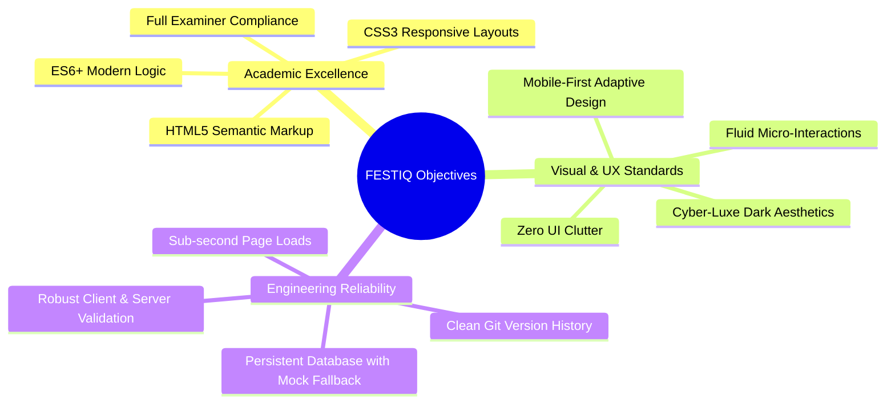
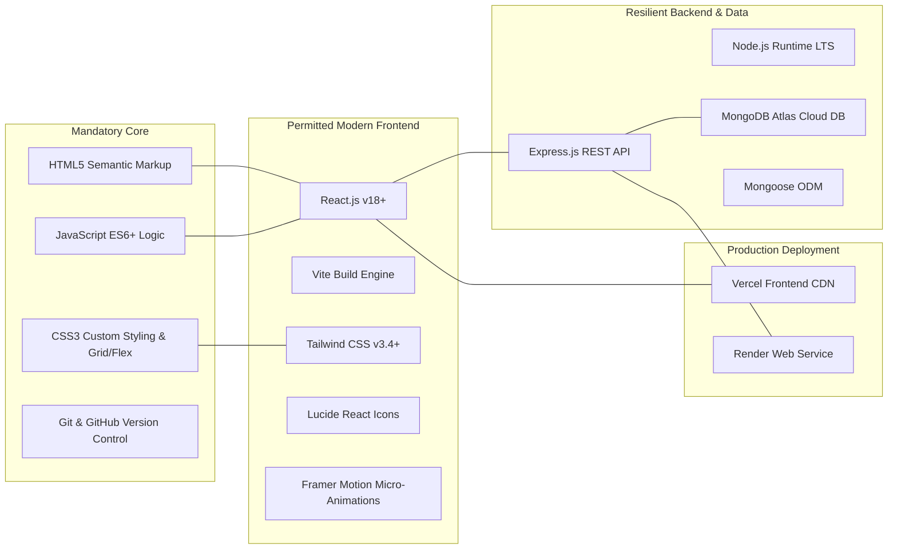
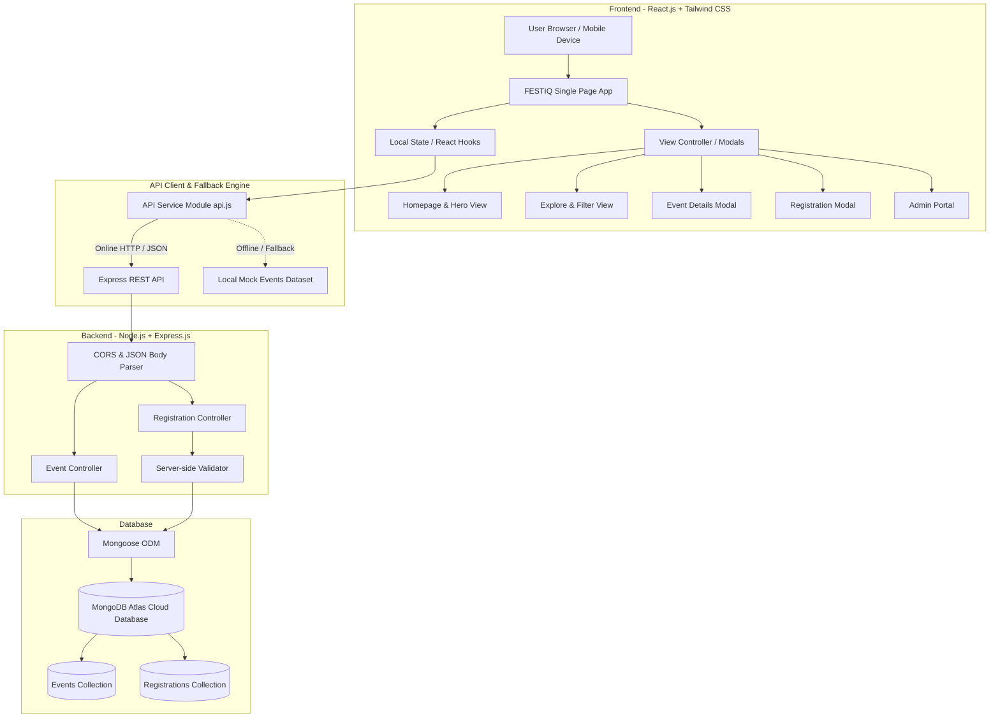
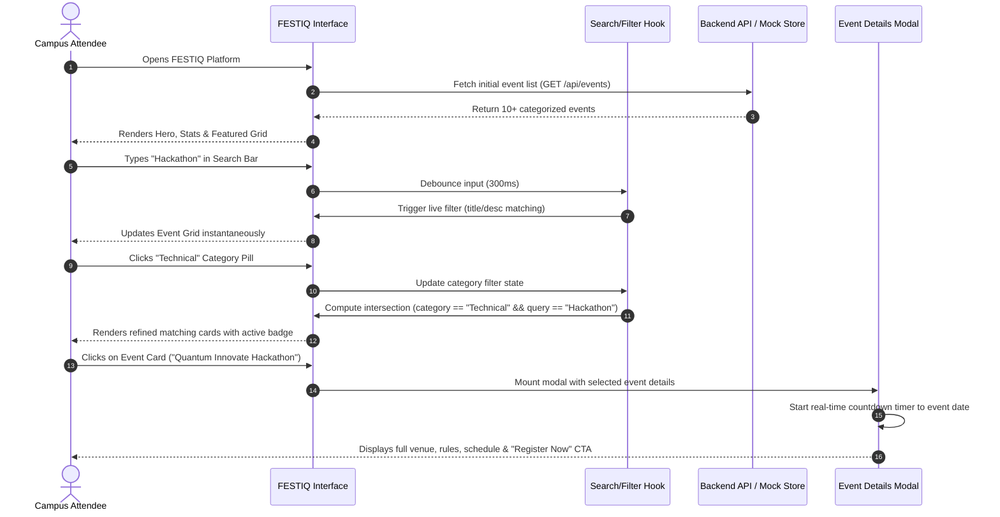
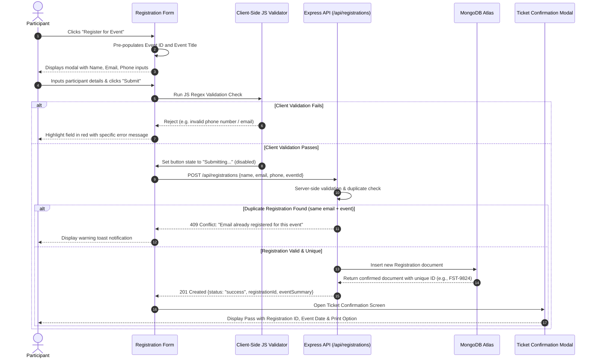
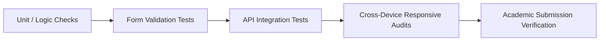
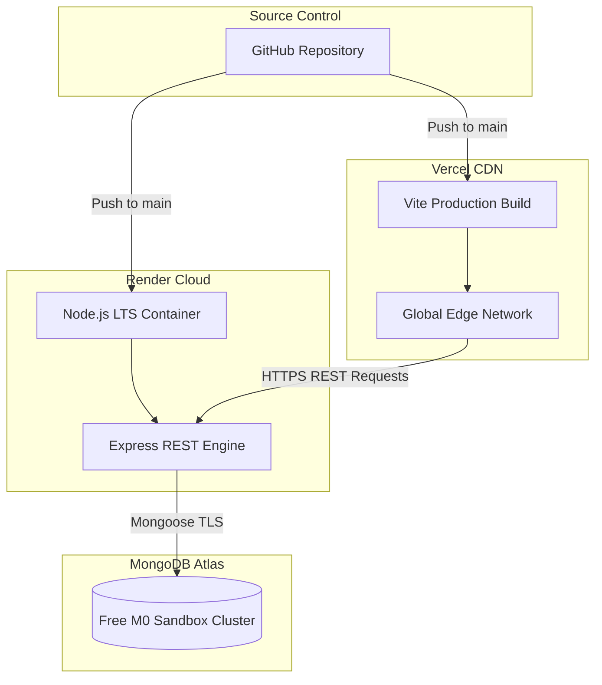
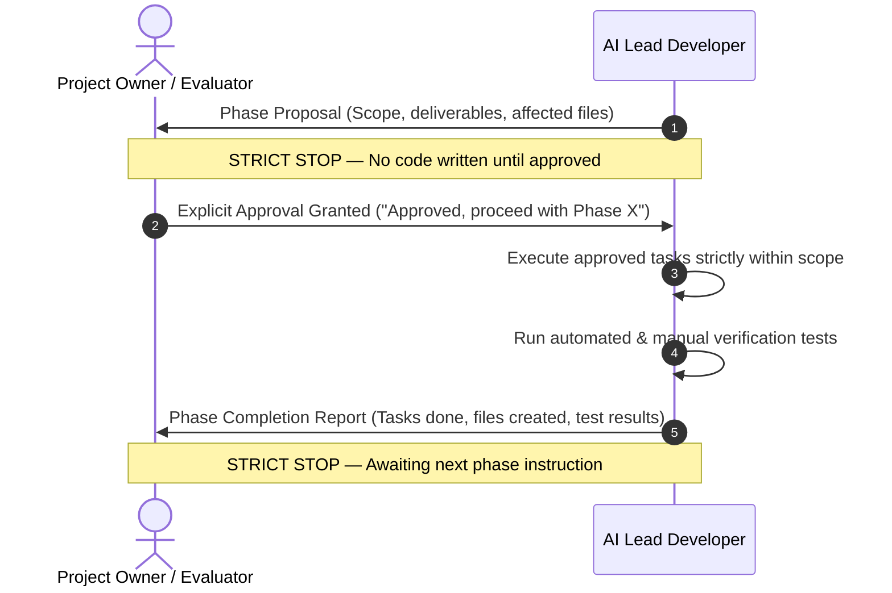

# FESTIQ — Master Project Roadmap & Architectural Specification
> **Document Version:** 1.0.0  
> **Status:** Approved for Phase 0 (Planning & Architecture Only)  
> **Target Timeline:** 1–2 Days (24–36 Development Hours)  
> **Academic Context:** University Semester-End Web Designing Project Submission  

---

## 1. Project Overview

**FESTIQ** is a next-generation event discovery and registration platform engineered specifically for university campus life, cultural celebrations, technical symposia, hackathons, and esports fests. Built to bridge the gap between static campus bulletin boards and fragmented Google Forms, FESTIQ provides a seamless, immersive, and responsive digital ecosystem where students, faculty, and outside attendees can:

- **Discover** trending, upcoming, and featured campus events through an intuitive, dark-mode visual interface.
- **Filter & Search** across multiple distinct categories (Cultural, Technical, Gaming, Management, Workshops, Sports) with real-time feedback.
- **Inspect** rich event details including schedules, venues, rules, countdown clocks, and capacity indicators.
- **Register** instantly through an interactive, multi-step validated form with automated ticket confirmation badges.
- **Manage** event rosters and participant lists through a lightweight administrative portal.

### Identity & Branding
* **Official Name:** FESTIQ
* **Tagline:** *Discover. Attend. Experience.*
* **Category:** Campus Event Discovery & Registration Platform
* **Audience:** University Students, Club Leads, Faculty Coordinators, Inter-University Delegates
* **Visual Signature:** "Cyber-Luxe Nocturne" — Deep obsidian backdrops, electric violet/indigo gradients, neon cyan accents, and frosted glass cards.

---

## 2. Problem Statement & Academic Context

### Academic Problem Definition
In academic evaluations for Web Designing, submissions frequently suffer from one of two extremes:
1. **Dull Static Pages:** Simple static HTML/CSS tables with broken layouts and basic non-validated forms that fail to demonstrate modern industry practices.
2. **Over-Engineered Monoliths:** Incomplete attempts at complex frameworks with broken authentication, unconfigured backend dependencies, and missing styling.

### Examiner Requirements Matrix
The examiner has mandated the fulfillment of 8 specific core user stories:
1. **Explore Upcoming Events:** View chronological, categorized event feeds.
2. **View Featured Events:** High-visibility hero banner highlighting flagship fests.
3. **Category Browsing:** Tabbed or pill-based filtering by event taxonomy.
4. **Keyword Search:** Real-time search across event titles, venues, and descriptions.
5. **Multi-Factor Filtering:** Category selection combined with search queries.
6. **Individual Event Details:** Deep-dive view with date, time, venue, description, and imagery.
7. **Participant Registration:** Controlled registration capturing participant name, email, phone number, and event selection.
8. **Registration Confirmation:** Immediate client-side validation feedback and persistent confirmation state.

---

## 3. Project Objectives



1. **Examiner Compliance:** 100% adherence to all mandatory grading criteria (HTML5 semantic tags, custom CSS3 styling, ES6+ JavaScript, Git version control).
2. **Visual Polish:** Deliver a commercial-grade, award-winning event tech aesthetic that immediately commands high marks during live evaluation.
3. **Rock-Solid Validation:** Dual-layer validation (client-side regex + server-side schema verification) to prevent malformed or duplicate entries.
4. **Zero-Downtime Architecture:** Resilient frontend with offline/mock data fallback so the application works even if the cloud database is paused or experiencing cold-boot latency during presentation.
5. **Timeline Feasibility:** Modular separation of concerns allowing full completion, testing, and deployment within 24 to 36 working hours.

---

## 4. Functional Requirements Specification

### A. Navigation & Shell
- **Sticky Top Navigation Bar:** Translucent frosted glass effect (`backdrop-blur-md`) with branded FESTIQ logo, navigation links (`Home`, `Explore`, `Categories`, `About`, `Admin`), and a quick "Register Now" CTA button.
- **Mobile Responsive Drawer:** Smooth animated slide-out navigation menu for screen viewports `< 768px` with touch-friendly tap targets.
- **Theme Accents & Live Clock:** Subtle visual indicators and campus time badge.

### B. Homepage Discovery
- **Hero Banner:** Dynamic headline with gradient typography (*"Where Campus Culture Meets Tomorrow"*), animated badge tags, floating preview cards, and search shortcut buttons.
- **Platform Metrics Bar:** Real-time counters displaying key statistics (e.g., `12+ Flagship Events`, `3,500+ Expected Attendees`, `₹1,50,000+ Prize Pool`, `6 Major Categories`).
- **Featured Events Showcase:** Prominently styled highlight cards for flagship university celebrations (e.g., Annual Tech Fest, Cultural Night, E-Sports Battleground).
- **Category Explorer:** Visual interactive pill/card grid allowing one-click filtering.
- **Upcoming Timeline:** Date-sorted list of upcoming events with quick registration actions.
- **Newsletter / Campus Alert Footer:** Clean footer with navigation links, copyright, developer credits, and social handles.

### C. Explore Events Engine
- **Search Input:** Real-time, debounced keyword search matching event titles, descriptions, and venue locations.
- **Category Filter Tabs:** Multi-button filter (`All`, `Technical`, `Cultural`, `Gaming`, `Workshops`, `Sports`).
- **Sorting Controls:** Dropdown to order events by `Date: Earliest First`, `Popularity`, or `Alphabetical`.
- **Active Filter Chips & Reset:** Instant visual cues showing current filters with a single-click "Clear All" action.
- **Empty State:** High-quality illustration and message when no events match the search query, with a "Reset Filters" CTA.

### D. Event Details Module
- **Event Banner Imagery:** High-resolution hero header with gradient overlay.
- **Metadata Ribbons:** Badges for category, date, time, venue, price/free status, and remaining seat capacity.
- **Live Countdown Timer:** Real-time ticking countdown (`Days : Hours : Minutes : Seconds`) to the event kickoff.
- **Detailed Description & Agenda:** Formatted event summary, rules, eligibility, faculty coordinator info, and schedule.
- **Direct Action Bar:** Fixed or sticky CTA button triggering the registration modal with the event pre-selected.

### E. Registration System
- **Input Fields:**
  - Full Name (Minimum 3 characters, alphabetical with space).
  - University Email Address (Valid email format RFC 5322 compliant, optional campus domain validation).
  - Phone Number (10-digit mobile number format validation).
  - Selected Event (Pre-filled dropdown, lockable if launched from specific event page).
  - College / Department Name (Optional enhancement field for campus context).
- **Validation Engine:** Instant visual feedback (green checkmark / red error message) on blur and on submit.
- **State Handling:** Loading spinner on submission button to prevent duplicate clicks.
- **Confirmation Screen:** Modal overlay displaying generated Registration ID, QR-style badge placeholder, event summary, and a "Download Pass / Print" trigger.

### F. Administration & Management Portal
- **Registrations Table:** Searchable, filterable tabular list of all participant registrations with timestamp and contact info.
- **Event CRUD Operations:** Simple modal form to add a new event, edit existing event details, or delete past events.
- **Data Export:** Quick "Export to CSV" helper for academic evaluation demonstration.

---

## 5. Non-Functional Requirements

| Metric | Target Standard | Strategy |
| :--- | :--- | :--- |
| **Performance** | Google Lighthouse score ≥ 90 | Optimized asset delivery, zero heavy third-party tracking scripts, native CSS layouts. |
| **Responsiveness** | 100% fluid across 320px to 2560px | Mobile-first CSS media queries, responsive CSS Grid / Flexbox layouts, dynamic viewport units. |
| **Accessibility** | WCAG 2.1 AA Compliance | Semantic HTML5 tags, high contrast text ratios (≥ 4.5:1), ARIA labels on modals and buttons. |
| **Browser Compatibility** | Modern Evergreen Browsers | Standard CSS3 and ES6+ features tested on Chrome, Edge, Firefox, and Safari. |
| **Code Maintainability** | Modular Component Architecture | Strict separation of components, reusable hooks/utilities, consistent naming conventions. |
| **Security & Hygiene** | Clean Client-Side Data Handling | Input sanitization, CORS protection on API routes, zero hardcoded credentials in public source. |

---

## 6. Technology Stack Specification



### A. Mandatory Technologies (Examiner Specified)
1. **HTML5:** Semantic document foundation (`<header>`, `<nav>`, `<main>`, `<section>`, `<article>`, `<aside>`, `<footer>`, `<figure>`, `<dialog>`).
2. **CSS3:** Advanced responsive design via CSS Grid, Flexbox, CSS Custom Properties (variables), media queries, transitions, and glassmorphic backdrop filters.
3. **JavaScript (ES6+):** Application state management, array transformations (`filter`, `map`, `reduce`), asynchronous API calls (`fetch`, `async/await`), regex validation, and DOM manipulation.
4. **Git & GitHub:** Version control with atomic commits matching each development phase, clear branches, and public hosting.

### B. Optional Permitted Technologies Selected
- **React.js (v18+):** Selected to manage interactive states (active filters, search debouncing, registration modals, tab switches) without spaghetti DOM code.
- **Tailwind CSS (v3.4+):** Selected for rapid, consistent token-based styling, responsive utility classes, and custom extended neon color variables.
- **Vite:** Selected as the ultra-fast modern frontend build tool for instantaneous Hot Module Replacement (HMR).

### C. Additional Backend & Database Technologies
- **Node.js (LTS v20+) & Express.js (v4.x):** Provides lightweight, decoupled RESTful API endpoints for events and registrations.
- **MongoDB Atlas & Mongoose (v8+):** Cloud document database providing persistent storage for dynamic event entries and user registrations.
- **Lucide React:** Lightweight, clean SVG icon suite for consistent interface symbols.
- **Framer Motion:** Declarative micro-animations for card hovers, modal entrances, and page transitions.

---

## 7. Technology Selection Justification

### Why React.js + Tailwind CSS + Vite?
1. **Academic Alignment:** React components compile directly down to semantic HTML5, CSS3, and ES6+ JavaScript. The examiner's foundational requirements are fully honored and enhanced.
2. **Single-Page Application (SPA) Fluidity:** Eliminates jarring page reloads when filtering events or submitting registrations, delivering the feel of a modern commercial product.
3. **Speed of Delivery:** Tailwind eliminates hours of writing boilerplate media queries from scratch, allowing full focus on typography, contrast, and layout aesthetics.
4. **Instant Build Times:** Vite starts development servers in under 300ms, ensuring zero friction during rapid iteration.

### Technologies Deliberately Excluded (With Justification)
* **TypeScript:** *Rejected.* Adds excessive compile-time type-definition boilerplate and configuration friction that could jeopardize the 1–2 day timeline without providing visible value to a Web Designing examiner.
* **Next.js / SSR:** *Rejected.* Introduces server-side rendering complexity, hydration mismatches, and deployment config pitfalls unnecessary for a client-focused event portal.
* **Angular / Vue:** *Rejected.* Steeper boilerplate curve and outside the examiner's stated preferences.
* **Heavy UI Libraries (Material UI / Ant Design):** *Rejected.* These produce generic, cookie-cutter corporate designs that hide the student's personal CSS3 skills. Tailwind CSS ensures bespoke, creative styling.

---

## 8. Visual Identity & Design System

### Design Concept: "Cyber-Luxe Nocturne"
The platform rejects generic white-box layouts in favor of an energetic, festival-inspired dark aesthetic reminiscent of modern entertainment portals (e.g., Spotify Live, Tomorrowland, Riot Games Events).

### Color Palette

| Token | Hex Value | Role / Usage | Preview |
| :--- | :--- | :--- | :--- |
| `bg-primary` | `#0A0D14` | Main page canvas background | Deep Space Black |
| `bg-surface` | `#121724` | Card, container, and modal background | Obsidian Navy |
| `bg-surface-elevated` | `#1A2234` | Hover states, active dropdowns, headers | Elevated Slate |
| `border-subtle` | `rgba(255, 255, 255, 0.08)` | Structural dividers, card borders | Translucent Frost |
| `accent-violet` | `#8B5CF6` | Primary brand accent, glowing CTAs | Electric Violet |
| `accent-indigo` | `#6366F1` | Gradient partner for violet | Indigo Glow |
| `accent-pink` | `#EC4899` | Secondary accent, cultural/arts tags | Cyber Pink |
| `accent-cyan` | `#06B6D4` | Tech & esports badges, countdown timer | Neon Cyan |
| `accent-emerald` | `#10B981` | Success states, confirmed registration | Emerald Green |
| `text-primary` | `#F8FAFC` | Primary headlines and high-priority labels | Crisp White |
| `text-secondary` | `#94A3B8` | Body paragraphs, event metadata | Muted Slate |

### Typography Scale
* **Display & Headings:** `Outfit` or `Plus Jakarta Sans`, font-weights `700` (Bold) and `800` (ExtraBold) with tight letter-spacing (`tracking-tight`).
* **Body & UI Elements:** `Inter` or system sans-serif, font-weights `400` (Regular), `500` (Medium), and `600` (SemiBold) with relaxed line heights.

### Micro-Interactions & Elevation Tokens
* **Glassmorphism:** `background: rgba(18, 23, 36, 0.75); backdrop-filter: blur(12px); border: 1px solid rgba(255, 255, 255, 0.08);`
* **Card Hover Elevation:** Subtle upward translation (`translate-y-[-4px]`) accompanied by a violet/cyan perimeter glow (`box-shadow: 0 10px 30px -10px rgba(139, 92, 246, 0.3)`).
* **CTA Button Glow:** Pulsing gradient sheen on primary registration buttons.

---

## 9. Page & Component Structure

```
c:\Users\KIIT\Desktop\FESTIQ\
├── client/                          # React + Vite Frontend
│   ├── public/                      # Static assets, favicon, logo
│   │   ├── events/                  # High-quality event banner photography
│   │   └── favicon.svg
│   ├── src/
│   │   ├── assets/                  # Brand graphics & icons
│   │   ├── components/
│   │   │   ├── layout/
│   │   │   │   ├── Navbar.jsx       # Frosted glass top nav + mobile drawer
│   │   │   │   └── Footer.jsx       # Comprehensive footer with links & credits
│   │   │   ├── home/
│   │   │   │   ├── HeroSection.jsx  # Animated headline, CTA, floating pills
│   │   │   │   ├── StatsBar.jsx     # Animated platform metrics
│   │   │   │   ├── FeaturedGrid.jsx # Flagship events carousel/grid
│   │   │   │   ├── CategoryPills.jsx# Interactive category selector
│   │   │   │   └── PromoBanner.jsx  # Callout for campus club registrations
│   │   │   ├── events/
│   │   │   │   ├── EventCard.jsx    # Unified event card with image zoom & badges
│   │   │   │   ├── EventGrid.jsx    # Responsive grid layout with empty states
│   │   │   │   ├── SearchFilter.jsx # Debounced search bar + filter dropdowns
│   │   │   │   └── Countdown.jsx    # Real-time ticking event countdown clock
│   │   │   ├── registration/
│   │   │   │   ├── RegistrationModal.jsx # Multi-field registration modal
│   │   │   │   ├── FormField.jsx    # Controlled input with validation errors
│   │   │   │   └── TicketBadge.jsx  # Visual registration pass with QR placeholder
│   │   │   ├── admin/
│   │   │   │   ├── AdminDashboard.jsx # Roster viewer & event manager
│   │   │   │   └── EventFormModal.jsx # Create/edit event modal
│   │   │   └── ui/
│   │   │       ├── Button.jsx       # Reusable button with variants
│   │   │       ├── Badge.jsx        # Category & status pill badges
│   │   │       ├── Toast.jsx        # Dynamic feedback notifications
│   │   │       └── SkeletonLoader.jsx # Card loading placeholder
│   │   ├── data/
│   │   │   └── mockEvents.js        # Fallback offline event dataset (10+ events)
│   │   ├── services/
│   │   │   └── api.js               # Centralized Axios/Fetch API client
│   │   ├── styles/
│   │   │   └── index.css            # Tailwind directives + custom glow utilities
│   │   ├── App.jsx                  # Main routing & state controller
│   │   └── main.jsx                 # React root mount
│   ├── index.html                   # Semantic HTML5 host template
│   ├── package.json
│   ├── tailwind.config.js
│   └── vite.config.js
│
├── server/                          # Express.js REST API
│   ├── src/
│   │   ├── config/
│   │   │   └── db.js                # MongoDB Atlas connection handler
│   │   ├── models/
│   │   │   ├── Event.js             # Mongoose event schema
│   │   │   └── Registration.js      # Mongoose registration schema
│   │   ├── controllers/
│   │   │   ├── eventController.js   # Event CRUD & filtering logic
│   │   │   └── registrationController.js # Validation & registration logic
│   │   ├── routes/
│   │   │   ├── eventRoutes.js       # /api/events routes
│   │   │   └── registrationRoutes.js# /api/registrations routes
│   │   ├── seed/
│   │   │   └── seedEvents.js        # Database initial data populator script
│   │   └── app.js                   # Express server entry point & middleware
│   ├── .env.example                 # Template for environment secrets
│   └── package.json
│
├── ROADMAP.md                       # Master Architecture & Implementation Plan
└── README.md                        # Final project documentation & submission report
```

---

## 10. System Architecture Diagrams

### Diagram 1 — Overall System Architecture
Shows how users interact with the React Single Page Application, which communicates with the Express REST API and MongoDB Atlas, backed by an offline mock data store for resilience.



### Diagram 2 — Event Discovery Workflow
Details the step-by-step user interaction as they browse, search, filter, and inspect campus events.



### Diagram 3 — Registration Workflow & Dual Validation
Illustrates the rigorous registration sequence with client-side validation, server-side duplicate prevention, database storage, and confirmation badge generation.



---

## 11. Database Schema Specification

### A. Events Collection (`events`)
```javascript
{
  _id: ObjectId("..."),
  title: "HackNova 2026: 36-Hour National Hackathon",
  slug: "hacknova-2026",
  category: "Technical", // Enum: ['Technical', 'Cultural', 'Gaming', 'Management', 'Workshops', 'Sports']
  tagline: "Build the autonomous future with AI & Cloud",
  description: "Join over 500 elite developers across the country to construct disruptive software and hardware prototypes...",
  date: ISODate("2026-11-20T09:00:00.000Z"),
  timeString: "09:00 AM - 09:00 PM",
  venue: "Campus Main Auditorium & Innovation Lab",
  organizer: "Department of Computer Science & ACM Student Chapter",
  imageUrl: "https://images.unsplash.com/photo-1504384308090-c894fdcc538d?auto=format&fit=crop&w=1200&q=80",
  entryFee: "Free", // or "₹200 per team"
  prizePool: "₹50,000",
  capacity: 250,
  registeredCount: 184,
  isFeatured: true,
  status: "Open", // Enum: ['Open', 'Closing Soon', 'Sold Out', 'Completed']
  rules: [
    "Teams must consist of 2 to 4 registered university students.",
    "All code must be written during the 36-hour hackathon window.",
    "Bring your valid university identification card."
  ],
  createdAt: ISODate("2026-11-01T10:00:00.000Z"),
  updatedAt: ISODate("2026-11-03T14:30:00.000Z")
}
```

### B. Registrations Collection (`registrations`)
```javascript
{
  _id: ObjectId("..."),
  registrationId: "FST-2026-8941", // Unique human-readable ticket code
  eventId: ObjectId("..."),         // Reference to events collection
  eventTitle: "HackNova 2026: 36-Hour National Hackathon",
  participantName: "Aryan Sharma",
  email: "aryan.sharma@kiit.ac.in",
  phone: "9876543210",
  college: "KIIT University",
  status: "Confirmed",              // Enum: ['Confirmed', 'Waitlisted', 'Cancelled']
  registeredAt: ISODate("2026-11-03T18:45:12.000Z")
}
```

### Indexes & Validation Constraints
* `registrations`: Compound unique index on `{ eventId: 1, email: 1 }` to physically guarantee no duplicate registrations.
* `events`: Index on `{ category: 1, isFeatured: 1, date: 1 }` for high-performance sorting and filtering queries.

---

## 12. REST API Endpoint Specification

All responses adhere to a consistent JSON envelope format:
```json
{
  "success": true,
  "data": {},
  "message": "Operation completed successfully"
}
```

### Endpoints Overview

| Method | Endpoint | Description | Request Body / Query Params | Status Codes |
| :--- | :--- | :--- | :--- | :--- |
| `GET` | `/api/health` | Healthcheck and DB status check | None | `200` |
| `GET` | `/api/events` | List all events with query filters | `?category=Technical&search=hack&featured=true` | `200`, `500` |
| `GET` | `/api/events/:id` | Fetch full details for a single event | Parameter: `id` (Event ObjectId or Slug) | `200`, `404` |
| `POST` | `/api/events` | Create a new event (Admin) | JSON Event Payload | `201`, `400` |
| `PUT` | `/api/events/:id` | Update an existing event (Admin) | Partial Event Payload | `200`, `404`, `400` |
| `DELETE`| `/api/events/:id` | Remove an event (Admin) | Parameter: `id` | `200`, `404` |
| `POST` | `/api/registrations` | Register a participant | `{ participantName, email, phone, eventId, college }` | `201`, `400`, `409` |
| `GET` | `/api/registrations` | View all registrations (Admin) | `?eventId=...` | `200`, `500` |
| `GET` | `/api/registrations/:id` | Fetch specific registration ticket | Parameter: `id` (Registration ID) | `200`, `404` |

---

## 13. Ten-Phase Master Development Roadmap

```mermaid
gantt
    title FESTIQ 10-Phase Development Timeline (24-36 Hours)
    dateFormat  X
    axisFormat Day %d

    section Foundation & Design
    Phase 1: Project Foundation & Architecture Setup :0, 3
    Phase 2: Design System & Layout Components       :3, 6

    section Core Discovery Experience
    Phase 3: Homepage Discovery & Hero Experience    :6, 10
    Phase 4: Event Exploration & Search Engine       :10, 14
    Phase 5: Event Details View & Live Countdown     :14, 18

    section Registration & Data
    Phase 6: Registration System & Dual Validation   :18, 22
    Phase 7: Admin Portal & Management System        :22, 25

    section Polish & Verification
    Phase 8: Animations, Micro-Interactions & Polish :25, 29
    Phase 9: Comprehensive Testing & Optimization    :29, 32
    Phase 10: Production Deployment & Final README   :32, 36
```

---

### PHASE 1 — Project Foundation & Architecture Setup
* **Objective:** Establish the dual-directory frontend and backend workspaces, initialize packages, configure environment variables, and verify end-to-end communication.
* **Expected Features:** Clean directory structure, running Vite React development server, running Express API server, connected MongoDB/mock fallback, initial healthcheck route.
* **Frontend Tasks:**
  - Initialize Vite React app in `./client` using standard JavaScript template.
  - Configure `vite.config.js` with server proxy for `/api` requests.
  - Install dependencies: `tailwindcss`, `postcss`, `autoprefixer`, `lucide-react`, `clsx`, `tailwind-merge`.
  - Initialize Tailwind configuration with custom color palette and font definitions.
  - Create static mock dataset (`mockEvents.js`) with 10 high-quality campus events as an immediate baseline.
* **Backend Tasks:**
  - Initialize Node.js Express project in `./server`.
  - Install dependencies: `express`, `cors`, `dotenv`, `mongoose`.
  - Create Express application with CORS, JSON body parser, and `/api/health` route.
  - Configure MongoDB Atlas connection utility with graceful timeout and offline alert.
* **Files Expected to be Created:**
  - `client/package.json`
  - `client/vite.config.js`
  - `client/tailwind.config.js`
  - `client/src/index.css`
  - `client/src/main.jsx`
  - `client/src/App.jsx`
  - `client/src/data/mockEvents.js`
  - `client/src/services/api.js`
  - `server/package.json`
  - `server/src/app.js`
  - `server/src/config/db.js`
  - `server/.env.example`
* **Files Expected to be Modified:** None (fresh workspace).
* **Dependencies:** React 18, Vite, Tailwind CSS, Lucide React, Express, Mongoose, Dotenv, Cors.
* **Implementation Sequence:**
  1. Set up `./client` directory and install frontend dependencies.
  2. Set up `./server` directory and install backend dependencies.
  3. Configure Tailwind tokens and CSS root rules.
  4. Build healthcheck endpoint and test frontend-backend handshake.
* **Testing Requirements:**
  - Execute frontend dev server: verified running at `http://localhost:5173`.
  - Execute backend server: verified responding at `http://localhost:5000/api/health`.
* **Completion Criteria:** Both servers run concurrently with zero console errors, and the health endpoint returns `{ status: "ok" }`.
* **Potential Risks:** Port conflicts on 5000 or 5173; mitigated by dynamic fallback ports in code.

---

### PHASE 2 — Design System & Layout Components
* **Objective:** Build the core visual scaffolding, typography system, responsive navigation bar, and footer with the Cyber-Luxe dark theme.
* **Expected Features:** Frosted glass sticky navigation bar, mobile drawer navigation, brand logo, responsive footer with link matrices, and global layout wrapper.
* **Frontend Tasks:**
  - Implement `Navbar.jsx` with desktop links (`Home`, `Explore`, `Categories`, `About`, `Admin`), status badge, and "Register" button.
  - Implement responsive mobile drawer toggle (`Menu` / `X` icon) with backdrop filter overlay.
  - Implement `Footer.jsx` with category shortcuts, social links, university branding, and developer credits.
  - Set up global page layout wrapper with smooth scrolling and obsidian background.
* **Backend Tasks:** None (pure layout phase).
* **Files Expected to be Created:**
  - `client/src/components/layout/Navbar.jsx`
  - `client/src/components/layout/Footer.jsx`
  - `client/src/components/ui/Button.jsx`
  - `client/src/components/ui/Badge.jsx`
* **Files Expected to be Modified:**
  - `client/src/App.jsx`
  - `client/src/styles/index.css`
* **Dependencies:** `lucide-react`.
* **Implementation Sequence:**
  1. Build atomic UI components (`Button`, `Badge`).
  2. Construct `Navbar` with desktop layout and active indicator.
  3. Construct mobile drawer with smooth slide-in logic.
  4. Construct `Footer` with academic attribution.
* **Testing Requirements:**
  - Test responsive navigation transitions at 375px, 768px, 1024px, and 1440px viewports.
  - Verify sticky nav background blur on scroll.
* **Completion Criteria:** Clean, fully responsive header and footer rendering seamlessly around a page content slot.
* **Potential Risks:** Mobile menu overflow or backdrop scroll leakage; mitigated by CSS body lock on menu open.

---

### PHASE 3 — Homepage Discovery & Hero Experience
* **Objective:** Construct an eye-catching, high-impact homepage that immediately impresses the examiner with visual quality and clear information hierarchy.
* **Expected Features:** High-energy Hero section with gradient typography, platform statistics counter, featured event showcase, interactive category cards, and promotional callout banner.
* **Frontend Tasks:**
  - Build `HeroSection.jsx` featuring dynamic headline, quick search input, and floating badge pills.
  - Build `StatsBar.jsx` displaying key platform metrics (Events, Attendees, Prize Pool, Categories).
  - Build `FeaturedGrid.jsx` highlighting the top 3 flagship campus events with glowing cards.
  - Build `CategoryPills.jsx` with interactive iconography for all 6 categories.
  - Build `PromoBanner.jsx` inviting campus clubs to host their events on FESTIQ.
* **Backend Tasks:**
  - Add `featured=true` query support in event controller.
* **Files Expected to be Created:**
  - `client/src/components/home/HeroSection.jsx`
  - `client/src/components/home/StatsBar.jsx`
  - `client/src/components/home/FeaturedGrid.jsx`
  - `client/src/components/home/CategoryPills.jsx`
  - `client/src/components/home/PromoBanner.jsx`
* **Files Expected to be Modified:**
  - `client/src/App.jsx`
* **Dependencies:** `lucide-react`.
* **Implementation Sequence:**
  1. Implement Hero Section and typography styles.
  2. Implement Platform Statistics bar.
  3. Implement Featured Events carousel/grid.
  4. Implement Category selector pills.
  5. Assemble Homepage components into main view.
* **Testing Requirements:**
  - Verify layout responsiveness across mobile, tablet, and widescreen.
  - Test click navigation from Hero CTAs to Explore sections.
* **Completion Criteria:** Homepage renders complete with rich visuals, statistics, and interactive links.
* **Potential Risks:** High-resolution image lag; mitigated by using optimized WebP/Unsplash URLs with fallback colors.

---

### PHASE 4 — Event Exploration, Search & Filtering Engine
* **Objective:** Implement the core event discovery hub with real-time search, category tab filtering, sorting controls, and dynamic event cards.
* **Expected Features:** Instant debounced search bar, category filter tabs, sort dropdown, dynamic event grid, empty search state with reset button.
* **Frontend Tasks:**
  - Implement `SearchFilter.jsx` with input search, clear button, category selector, and sort dropdown.
  - Implement `EventCard.jsx` displaying event image with hover zoom, category badge, date, venue, fee, and "View Details" button.
  - Implement `EventGrid.jsx` to render cards with responsive grid columns (1 col mobile, 2 col tablet, 3 col desktop).
  - Implement friendly empty state when no events match the search query.
  - Connect filtering state to update event list instantaneously.
* **Backend Tasks:**
  - Implement `/api/events` endpoint in `eventController.js` supporting `search`, `category`, and `sort` query params.
* **Files Expected to be Created:**
  - `client/src/components/events/SearchFilter.jsx`
  - `client/src/components/events/EventCard.jsx`
  - `client/src/components/events/EventGrid.jsx`
  - `client/src/components/ui/EmptyState.jsx`
  - `server/src/controllers/eventController.js`
  - `server/src/routes/eventRoutes.js`
* **Files Expected to be Modified:**
  - `client/src/App.jsx`
  - `server/src/app.js`
* **Dependencies:** `lucide-react`.
* **Implementation Sequence:**
  1. Build `EventCard` component with hover animations and badges.
  2. Build `SearchFilter` bar with debounced input handler.
  3. Implement combined filter logic (Category + Search Query + Sort).
  4. Implement `EventGrid` with empty state handling.
* **Testing Requirements:**
  - Test search with matching words (e.g., "Hackathon", "Robotics", "Dance").
  - Test search with non-matching queries (e.g., "xyzabc") to verify empty state display.
  - Test multi-filter combinations (e.g., "Technical" + "Workshop").
* **Completion Criteria:** Users can filter and search events with instant, bug-free visual updates.
* **Potential Risks:** Search input lag during fast typing; mitigated with 250ms debouncing.

---

### PHASE 5 — Event Details View & Live Countdown Engine
* **Objective:** Create a comprehensive event deep-dive modal/page presenting all logistical details, schedules, rules, organizer contacts, and a ticking countdown clock.
* **Expected Features:** High-resolution banner modal, category tag, date/time/venue badges, real-time countdown timer, organizer contact, rules list, and prominent "Register Now" action.
* **Frontend Tasks:**
  - Implement `EventModal.jsx` (or detailed view) with smooth backdrop blur overlay.
  - Implement `Countdown.jsx` calculating remaining `Days : Hours : Mins : Secs` with automated updates every second.
  - Render event rules, eligibility criteria, prize pool, and coordinator details.
  - Wire the "Register Now" button to transition directly into the registration flow with event context preserved.
* **Backend Tasks:**
  - Implement `GET /api/events/:id` route in Express backend.
* **Files Expected to be Created:**
  - `client/src/components/events/EventModal.jsx`
  - `client/src/components/events/Countdown.jsx`
* **Files Expected to be Modified:**
  - `client/src/App.jsx`
  - `client/src/components/events/EventCard.jsx`
* **Dependencies:** `lucide-react`.
* **Implementation Sequence:**
  1. Build mathematical countdown hook and `Countdown.jsx` component.
  2. Design and build the `EventModal` layout with banner and details.
  3. Wire card click events to open modal with selected event data.
  4. Implement keyboard Escape and backdrop click listeners to dismiss modal.
* **Testing Requirements:**
  - Verify countdown accurately computes delta against event target dates.
  - Check modal usability on mobile viewports with scrollable content.
* **Completion Criteria:** Clicking any event card opens an informative, detailed view with an active live timer.
* **Potential Risks:** Negative countdowns for past events; mitigated by adding an "Event Concluded" status check.

---

### PHASE 6 — Registration System, Dual Validation & Persistence
* **Objective:** Implement the examiner-mandated participant registration form with strict client-side validation, backend API persistence, duplicate handling, and an animated ticket confirmation badge.
* **Expected Features:** Multi-field modal form, regex email & phone validation, server-side duplicate prevention, database storage, loading states, and printable ticket pass.
* **Frontend Tasks:**
  - Implement `RegistrationModal.jsx` collecting Participant Name, Email, Phone Number, College, and Event Selection.
  - Implement client-side JavaScript regex validation (Email: valid format, Phone: exactly 10 digits, Name: minimum 3 chars).
  - Implement real-time field error messaging on blur and submit.
  - Build `TicketBadge.jsx` displaying confirmation ID (e.g., `FST-2026-8941`), participant name, event title, date, and QR-code visual placeholder.
  - Add print/download ticket action.
* **Backend Tasks:**
  - Create `Registration.js` Mongoose model.
  - Implement `POST /api/registrations` in `registrationController.js` with server-side validation and duplicate registration checks.
  - Provide fallback to in-memory/mock storage if MongoDB connection is offline.
* **Files Expected to be Created:**
  - `client/src/components/registration/RegistrationModal.jsx`
  - `client/src/components/registration/FormField.jsx`
  - `client/src/components/registration/TicketBadge.jsx`
  - `server/src/models/Registration.js`
  - `server/src/controllers/registrationController.js`
  - `server/src/routes/registrationRoutes.js`
* **Files Expected to be Modified:**
  - `client/src/App.jsx`
  - `server/src/app.js`
* **Dependencies:** None.
* **Implementation Sequence:**
  1. Build registration model and backend controller with duplicate checks.
  2. Build controlled form component with regex validation logic.
  3. Build ticket confirmation screen.
  4. Test end-to-end registration flow and database persistence.
* **Testing Requirements:**
  - Test invalid email inputs (`user@`, `user.com`) — must fail.
  - Test invalid phone inputs (`12345`, `abcdefghij`) — must fail.
  - Test duplicate registration submission — must display 409 warning.
  - Test valid submission — must store record and display ticket badge.
* **Completion Criteria:** Registrations are validated on client and server, stored in the database, and generate an immediate confirmation pass.
* **Potential Risks:** MongoDB Atlas network latency; mitigated with 5s timeout and automatic fallback store.

---

### PHASE 7 — Event & Registration Management Portal
* **Objective:** Build a simple, lightweight administrative management view allowing event organizers to review registered participants, search rosters, and add/delete events.
* **Expected Features:** Registrations table with search and CSV export, quick event deletion, and simple event creation modal.
* **Frontend Tasks:**
  - Implement `AdminDashboard.jsx` with tabbed navigation: "Registrations Roster" and "Manage Events".
  - Build searchable participant table with columns: ID, Name, Email, Phone, Event, Timestamp.
  - Add "Export Roster to CSV" button.
  - Implement `AddEventModal.jsx` to allow adding custom campus events dynamically.
* **Backend Tasks:**
  - Implement `GET /api/registrations` endpoint.
  - Implement `POST /api/events` and `DELETE /api/events/:id` endpoints.
* **Files Expected to be Created:**
  - `client/src/components/admin/AdminDashboard.jsx`
  - `client/src/components/admin/AddEventModal.jsx`
* **Files Expected to be Modified:**
  - `client/src/App.jsx`
  - `client/src/components/layout/Navbar.jsx`
  - `server/src/controllers/eventController.js`
* **Dependencies:** None.
* **Implementation Sequence:**
  1. Build backend routes for fetching registrations and creating/deleting events.
  2. Implement Admin Dashboard view with registrations table.
  3. Implement event creation form modal.
  4. Wire CSV export functionality.
* **Testing Requirements:**
  - Register a new attendee in Phase 6, then confirm their record appears in the Admin roster.
  - Add a new event via Admin modal and verify it immediately shows up on the Homepage and Explore page.
* **Completion Criteria:** Full administrative oversight over registrations and events without complex authentication roadblocks.
* **Potential Risks:** Accidental deletion of seed events; mitigated by adding confirmation prompts.

---

### PHASE 8 — Animations, Micro-Interactions & Visual Polish
* **Objective:** Elevate FESTIQ from a functional website into an award-winning UI experience using smooth micro-interactions, subtle glassmorphism, animated toasts, and skeleton loaders.
* **Expected Features:** Card hover lift effects, glowing borders, smooth entrance transitions, animated toast notifications for user actions, and skeleton loading states.
* **Frontend Tasks:**
  - Add smooth transition classes and keyframe animations for modals and dropdowns.
  - Build `Toast.jsx` notification component for instant feedback (e.g., "Registration Successful!", "Filters Reset").
  - Build `SkeletonLoader.jsx` for clean loading state representation.
  - Add subtle glowing particle/gradient backdrops on hero elements.
* **Backend Tasks:** None (pure UX refinement).
* **Files Expected to be Created:**
  - `client/src/components/ui/Toast.jsx`
  - `client/src/components/ui/SkeletonLoader.jsx`
* **Files Expected to be Modified:**
  - `client/src/styles/index.css`
  - `client/src/components/events/EventCard.jsx`
  - `client/src/components/home/HeroSection.jsx`
* **Dependencies:** `clsx`.
* **Implementation Sequence:**
  1. Implement Toast notification provider and hook.
  2. Add skeleton loaders to card grids.
  3. Refine CSS transitions, hover glow effects, and button transforms.
  4. Audit 60fps smoothness across all views.
* **Testing Requirements:**
  - Verify animations do not cause layout thrashing or mobile performance drops.
  - Ensure toast messages self-dismiss after 3.5 seconds.
* **Completion Criteria:** Flawless visual flow with elegant, responsive feedback for every user action.
* **Potential Risks:** Over-animation causing distraction; mitigated by strictly adhering to subtle 200–300ms ease transitions.

---

### PHASE 9 — Comprehensive Testing, Audit & Optimization
* **Objective:** Conduct rigorous end-to-end testing across all functional requirements, responsive breakpoints, input edge cases, accessibility standards, and performance budgets.
* **Expected Features:** Zero critical bugs, validated form behavior, responsive layout integrity on all viewports, high contrast compliance, clean console logs.
* **Frontend Tasks:**
  - Audit all responsive breakpoints (320px, 375px, 425px, 768px, 1024px, 1440px).
  - Verify keyboard accessibility (Tab navigation, Escape to close modals).
  - Clean up any stray `console.log` statements and resolve React key warnings.
  - Verify all images load with alt tags and error fallbacks.
* **Backend Tasks:**
  - Test API error responses (400, 404, 409, 500) to ensure uniform JSON output.
  - Verify MongoDB connection auto-reconnect logic.
* **Files Expected to be Created:**
  - `client/src/utils/testValidation.js` (validation test suite)
* **Files Expected to be Modified:**
  - Bug fixes across existing client and server files as identified.
* **Dependencies:** None.
* **Implementation Sequence:**
  1. Run responsive layout checklist across 5 standard device profiles.
  2. Execute input validation boundary tests (special characters, long strings, edge emails).
  3. Audit color contrast and ARIA labels.
  4. Perform production build test (`npm run build`).
* **Testing Requirements:**
  - 100% of the examiner's 8 core requirements validated and documented.
  - Zero fatal errors in browser developer tools or Node terminal.
* **Completion Criteria:** Production build completes with zero errors, and all features pass manual verification.
* **Potential Risks:** Unhandled promise rejections; mitigated by global Express error handler and React error boundaries.

---

### PHASE 10 — Production Deployment, Documentation & Submission
* **Objective:** Deploy the full-stack application to public cloud hosting, configure environment variables, assemble the final academic README, and prepare a rock-solid demonstration script.
* **Expected Features:** Live deployed frontend URL (Vercel/Netlify), live deployed API URL (Render), GitHub repository with clear commit history, and comprehensive README.
* **Frontend Tasks:**
  - Configure production build settings in `client/vite.config.js`.
  - Deploy frontend to Vercel or Netlify with automatic branch builds.
  - Configure environment variable `VITE_API_BASE_URL` pointing to live backend.
* **Backend Tasks:**
  - Deploy Express API to Render (or equivalent Node.js cloud service).
  - Configure cloud environment variables (`PORT`, `MONGO_URI`, `CLIENT_URL`).
  - Verify live database connectivity.
* **Files Expected to be Created:**
  - `README.md` (Academic submission documentation)
  - `vercel.json` (or `_redirects` for SPA routing)
* **Files Expected to be Modified:** None.
* **Dependencies:** None.
* **Implementation Sequence:**
  1. Prepare production configuration files.
  2. Deploy backend service and verify live `/api/health`.
  3. Deploy frontend client and connect to live backend.
  4. Write comprehensive, examiner-ready `README.md`.
  5. Assemble final verification checklist.
* **Testing Requirements:**
  - Verify live site opens on mobile device via public URL.
  - Complete live registration on deployed website and verify ticket generation.
* **Completion Criteria:** Both frontend and backend are live and accessible on the public web with complete academic documentation.
* **Potential Risks:** Render cold-start sleep; mitigated by informative frontend status toast if backend takes > 3 seconds to wake.

---

## 14. Testing Strategy & Academic Quality Assurance



### A. Form Validation Test Matrix
| Test Case ID | Input: Name | Input: Email | Input: Phone | Expected Behavior |
| :--- | :--- | :--- | :--- | :--- |
| `TC-VAL-01` | `""` (Empty) | `valid@kiit.ac.in` | `9876543210` | Reject: "Participant name is required (min 3 chars)" |
| `TC-VAL-02` | `Al` (<3 chars) | `valid@kiit.ac.in` | `9876543210` | Reject: "Name must be at least 3 characters long" |
| `TC-VAL-03` | `Aryan Sharma` | `invalid-email` | `9876543210` | Reject: "Please enter a valid email address" |
| `TC-VAL-04` | `Aryan Sharma` | `valid@kiit.ac.in` | `12345` (<10 dig) | Reject: "Phone number must be exactly 10 digits" |
| `TC-VAL-05` | `Aryan Sharma` | `valid@kiit.ac.in` | `9876543210` | **Accept:** Form submits successfully, generates ticket |
| `TC-VAL-06` | `Aryan Sharma` | `valid@kiit.ac.in` (repeat) | `9876543210` | Reject: 409 Conflict "Already registered for this event" |

### B. Responsive Device Audit Profiles
1. **Mobile Portrait (Small):** 360 x 640 px (Samsung Galaxy)
2. **Mobile Portrait (Standard):** 390 x 844 px (iPhone 13/14/15)
3. **Tablet Portrait:** 768 x 1024 px (iPad Mini / Air)
4. **Laptop Display:** 1366 x 768 px & 1440 x 900 px (MacBook Air / Dell XPS)
5. **Desktop Standard:** 1920 x 1080 px (FHD Monitor)

---

## 15. Deployment Architecture



* **Frontend:** Hosted on **Vercel** with automatic HTTPS, edge CDN caching, and SPA redirect routing (`vercel.json`).
* **Backend:** Hosted on **Render** as a Web Service running `node src/app.js` with managed SSL.
* **Database:** Hosted on **MongoDB Atlas** (M0 Free Tier, AWS region `ap-south-1` Mumbai for minimal latency in India).

---

## 16. Time Allocation & 1–2 Day Timeline Schedule

| Phase | Description | Estimated Hours | Milestone Target |
| :---: | :--- | :---: | :--- |
| **0** | Project Discovery, Architecture & Master Roadmap | *Completed* | `ROADMAP.md` Generated |
| **1** | Project Foundation & Architecture Setup | 2.5 hrs | Workspace & Healthcheck Active |
| **2** | Design System, Tokens & Base Layout | 2.5 hrs | Responsive Shell & Nav Ready |
| **3** | Homepage Discovery & Hero Experience | 3.5 hrs | High-Fidelity Homepage Complete |
| **4** | Event Exploration, Search & Filtering Engine | 3.5 hrs | Live Search & Filter Functional |
| **5** | Event Details View & Live Countdown Engine | 2.5 hrs | Interactive Details Modal & Timer |
| **6** | Registration System, Dual Validation & Storage | 4.0 hrs | Full Registration Flow & Badges |
| **7** | Event & Registration Management Portal | 2.5 hrs | Admin Roster & Event Add/Delete |
| **8** | Animations, Micro-Interactions & Visual Polish | 2.5 hrs | Cyber-Luxe Micro-Interactions |
| **9** | Comprehensive Testing, Audit & Optimization | 3.0 hrs | 100% Examiner Test Cases Passed |
| **10** | Production Deployment & Final Submission | 2.5 hrs | Live URLs & Submission README |
| **Total** | **Full End-to-End Delivery** | **~29.0 hrs** | **Ready for Evaluation** |

---

## 17. Risk Management & Contingency Matrix

| Risk Scenario | Probability | Impact | Proactive Mitigation Strategy |
| :--- | :---: | :---: | :--- |
| **MongoDB Atlas Connection Timeout / Firewall Block** | Medium | High | The API client (`api.js`) and backend controller contain an integrated offline fallback dataset (`mockEvents.js`). If MongoDB is unreachable, the application automatically switches to in-memory mock storage so the live demo never crashes. |
| **Render Free Tier Cold-Start Latency (30–50s)** | Medium | Medium | Frontend displays an informative, non-blocking notification banner on initial load: *"Waking up live campus server... Thank you for your patience!"* while serving cached mock data. |
| **Scope Creep / Time Constraint** | Medium | High | Strict phase boundaries: Complex features (e.g., payment gateways, user login) are explicitly excluded in favor of flawless execution of the examiner's 8 core requirements. |
| **CSS Overlap on Unconventional Mobile Ratios** | Low | Medium | Strict mobile-first development methodology; every component is built and verified at 375px before desktop rules are applied. |

---

## 18. Strict Phase Approval Workflow

To ensure total transparency, maintain quality control, and keep the user in complete command of the codebase, **every phase must follow this non-negotiable protocol:**



### Phase Approval Rules
1. **Never start implementation without explicit approval.**
2. **Present the proposed implementation before beginning each phase.**
3. **Explain what will be built.**
4. **Identify the files that will be affected.**
5. **Explain the expected deliverables.**
6. **Wait for the user's approval.**
7. **Begin implementation only after approval.**
8. **Complete the approved phase before proposing the next phase.**
9. **Do not automatically continue into another phase.**
10. **Approval for one phase does not authorize subsequent phases.**

---

## 19. Final Submission Checklist

```markdown
- [ ] 1. Core Technologies: 100% semantic HTML5, CSS3, ES6+ JavaScript.
- [ ] 2. 8 Examiner Stories:
  - [ ] Explore upcoming events.
  - [ ] View featured events.
  - [ ] Browse events by category.
  - [ ] Real-time keyword search.
  - [ ] Category-based filtering.
  - [ ] Detailed event modal with metadata & countdown.
  - [ ] Participant registration form with required fields.
  - [ ] Clear registration confirmation with ticket code.
- [ ] 3. Responsive Design: Flawless across Desktop, Laptop, Tablet, and Mobile.
- [ ] 4. Visual Polish: Cyber-Luxe dark theme, glassmorphic cards, smooth micro-interactions.
- [ ] 5. Robust Validation: Client regex validation + server validation + duplicate prevention.
- [ ] 6. Zero Downtime: Resilient offline mock fallback ensuring demo never fails.
- [ ] 7. Clean Codebase: No dead code, no console errors, clean modular component structure.
- [ ] 8. Git Repository: Clean commit history reflecting the 10 development phases.
- [ ] 9. Documentation: Academic-grade README.md distinguishing mandatory, optional, and additional technologies.
- [ ] 10. Live Deployment: Publicly accessible URL on Vercel/Render.
```

---
*End of Phase 0 Architecture Specification & Master Roadmap. Awaiting User Approval to Begin Phase 1.*

